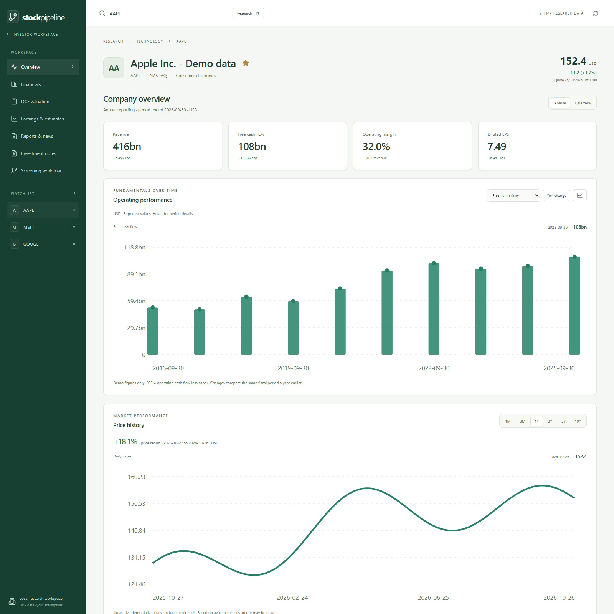
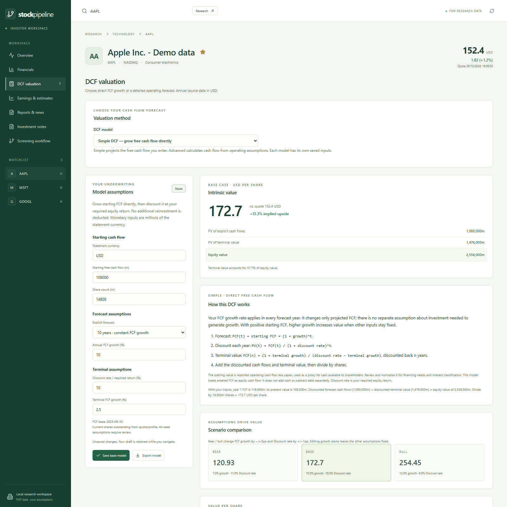

# Investor research guide

## Investor Workspace

The landing page is now company research (`/#research/AAPL`; substitute any supported ticker). Search by ticker and switch between Overview, Financials, DCF valuation, Earnings & estimates, Reports & news and Investment notes. **Screening workflow** opens the canvas at `/#screening` inside the same workspace sidebar, company search and watchlist. Its navigation entry stays highlighted while screening. On smaller screens, the workspace-page and watchlist selectors remain available on every page. The canvas remains mounted when switching views so the current workflow, results, selected node and active run are retained. A stock's screening sidebar links to company research.

Each research section has its own URL, such as `/#research/AAPL/financials`, so browser Back/Forward and direct links select the same section as the sidebar. The sidebar and mobile selector are the primary page navigation. Expanded screening results use the available workspace area without covering that navigation; settings move below the canvas on narrower screens. The stock details dialog supports Escape and contains keyboard focus until dismissed.

On **Financials**, select any metric row to chart its history. The selected row is highlighted, the chart metric updates and the view scrolls to the chart. Keyboard users can focus a metric's button and press Enter or Space. Row selection shows reported values first; use **YoY change** for growth or margin changes, and retain annual/quarterly and line/bar choices. The chart dropdown and table selection stay synchronized.

Unsaved DCF inputs and investment notes remain as per-company drafts while navigating, changing companies or reloading source data. Drafts are held in the current browser session; use the explicit Save action to keep them after a page reload or closing the site. Resetting a DCF applies the latest available source base. Line charts scale to the observed range, while bar charts retain a zero baseline. Margin changes are reported in percentage points in charts and tables.

### Workspace examples



*Company research with illustrative demo data, not current market results.*



*DCF with illustrative demo data and assumptions, not a current market valuation or price target.*

### From a screen to the watchlist

The star beside a company name on its research page already saves it to the browser's watchlist. Screening now uses that same list: click the star in a stock's row under **Stocks**, **Rank** or **Near misses**, or use **Add to watchlist** in the stock details sidebar. These actions work directly from the screening result, even if company details are loading or unavailable. A filled star means the stock is saved; click it again to remove it.

The **Watchlist (N)** action beside the results filter adds every matching stock in the selected node/outcome to the watchlist, including rows beyond the first 500 displayed. It respects the text filter and deduplicates stocks already saved; it does not imply all those stocks passed every screening step. The action is disabled when all matching stocks are already saved. The workspace watchlist updates immediately; choose a ticker there to research it and return to **Screening workflow** to resume the same screen. Saved symbols survive reloads and synchronize between tabs on the same origin. Existing saved watchlists are preserved. If browser storage is unavailable, a notification explains that updates last only for the current session.

Financial history uses the FMP stable income, balance-sheet and cash-flow endpoints with a separate research lookback of up to ten annual periods or forty quarters. Legacy screener lookbacks remain unchanged; the four TTM profitability screens use the forty-quarter research history described below. Select a metric, annual/quarterly reporting, YoY change, and line/bar presentation. Tables show vendor values in millions, except per-share values and ratios; CSV exports use raw units. FCF is operating cash flow minus absolute capex (vendor FCF is preferred when supplied). This reported FCF is not unlevered FCFF. Cash, debt and other balance-sheet figures are point-in-time observations; earnings and cash flows cover the stated period.

YoY compares dates 330–400 days apart and, for quarterly statements, the same fiscal quarter. Known matching currencies and positive prior bases are required. A negative or zero prior base has no percentage-growth result. Margin changes use percentage points. Mixed statement currencies are excluded from merged periods, and charts are withheld across changing reporting currencies. Missing values are never filled with zero. Dates and filing dates are preserved where FMP supplies them. Historical vendor statements may contain restatements; this is not a point-in-time backtest dataset.

Price history uses daily split-adjusted closes and excludes dividends. Period returns compare the first and last available closes within the selected range ending at the latest observation. The latest quote can have a different timestamp. News, analyst estimates, earnings and SEC coverage depend on your subscription and the company; unavailable datasets leave the rest of the page usable. SEC filings show at most the most recent 100 observations in a two-year window, including forms other than financial reports.

### DCF assumptions

**Simple DCF is the default.** Enter starting FCF, FCF growth, a five- or ten-year horizon, required equity return, terminal growth and shares. FCF grows at the selected rate throughout the explicit forecast; no extra investment is deducted. Each year's FCF is discounted at the required return. Terminal value is final-year FCF × (1 + terminal growth) / (required return − terminal growth), discounted to the base date. Add the present values and divide by shares. For positive starting FCF, higher forecast growth raises value when other inputs stay fixed.

Reported operating cash flow less capex seeds the simple model as an equity cash-flow proxy, not a complete FCFE calculation: review financing requirements, interest classification and normalisation. There is no separate cash addition or debt deduction. Required return must exceed nonnegative terminal growth. Negative or missing starting FCF requires a manually reviewed positive base. The cash-flow source currency is used when available. No revenue, margin, sales-to-capital or terminal ROIC assumption affects this model.

**Advanced DCF** retains the operating model below. Switching methods preserves each model's draft and saved inputs separately; existing saved operating models remain available under Advanced. Both methods show formulas and a worked calculation from current inputs on the page. Simple bear/bull cases change FCF growth by −/+3pp and required return by +/−1pp; its sensitivity grid varies required return and terminal growth. These are explicit scenario changes; editing growth alone does not change other input assumptions.

The valuation is intended for operating companies. Banks, insurers and REITs receive a notice to use a sector-specific model. It uses annual revenue and EBIT as its base, with the latest available quarterly cash/debt/claims balance (annual balance as fallback). Shares use current outstanding shares, then market cap divided by price, then annual weighted-average diluted shares, with the selected basis displayed. Review the fixed share count for future dilution.

- Explicit horizon: five or ten years. Growth is constant for years 1–5; a ten-year model fades growth linearly to terminal growth in years 6–10. EBIT margin moves linearly from base to target over the full horizon.
- NOPAT = EBIT − max(EBIT, 0) × cash tax rate. No loss carryforwards or tax benefits on losses.
- Net reinvestment = max(incremental revenue, 0) / sales-to-capital ratio. This covers net capex and working capital; no capital release is assumed for contraction. FCFF = NOPAT − net reinvestment.
- Terminal FCFF = next-year terminal NOPAT × (1 − terminal growth / terminal ROIC). Terminal value = terminal FCFF / (WACC − terminal growth). WACC and terminal ROIC must each exceed nonnegative terminal growth.
- End-year discounting; no stub-period adjustment from the annual base date to today. Enterprise value is the sum of discounted explicit FCFF and discounted terminal value.
- Equity value = enterprise value + cash − debt − minority/preferred claims; per-share value divides by the chosen fixed share count. Unknown bridge entries require explicit input. Cash is cash/equivalents only; investments and other nonoperating assets require manual review. Pension deficits, leases and other liabilities are not automatically adjusted.
- Stock compensation stays in the EBIT margin and is not added back. The default tax, growth, WACC, terminal growth, terminal ROIC and sales-to-capital assumptions are editable modelling placeholders, not consensus estimates.
- Bear/bull cases adjust base revenue growth by −/+3 percentage points, target EBIT margin by −/+2 points, and WACC by +/−1 point. The sensitivity grid varies WACC and terminal growth; inadmissible combinations show unavailable.
- Upside is shown only when the quote currency and model currency match exactly; there is no automatic FX or subunit conversion. A nonpositive model equity value is identified as a residual value rather than an executable stock-price target.

The approach follows [Damodaran's operating-company FCFF framework](https://pages.stern.nyu.edu/~adamodar/pdfiles/country/val2daySept24.pdf). The forecast, equity bridge and terminal-value weight are visible for audit. Save a base model per ticker in this browser or export JSON and forecast CSV; saving a bear/bull view still saves the editable base assumptions. Models, watchlists and notes are browser-local, do not sync across devices and can be lost when browser storage is cleared. Notes have a separate explicit Save action and JSON export.

**Reload data** refreshes page responses but respects provider caches: research statements up to 24 hours; daily prices reuse cached date coverage with daily recent-window refreshes (15 minutes for current-day or empty tails) and weekly full reconciliation; earnings and filings one hour; news 30 minutes. Company overviews and analyst estimates retain their existing provider cache policy. API keys remain in Python and are not sent to the frontend. The existing local-origin restriction and loopback binding remain in place; this change does not add public hosting, account access or trading.

The browser's response cache expires after five minutes and rechecks open datasets while the workspace remains mounted. Provider cache windows still apply. A failed refresh keeps the previous data visible with an error notice instead of discarding the research view.

Endpoint references: [FMP quickstart and stable statements](https://site.financialmodelingprep.com/developer/docs/quickstart), [earnings](https://site.financialmodelingprep.com/developer/docs/stable/earnings), [SEC filings by symbol](https://site.financialmodelingprep.com/developer/docs/stable/search-by-symbol).

## Screening research

Run a workflow, select an output node, then use the tabs in the results panel:

- **Stocks:** the original outcome table, CSV export and stock sidebar.
- **Rank:** each screener on the selected path becomes a separate factor. Adjust weights from 0 to 10. Values become percentiles within the selected outcome, using the applied rule's direction. Ties use midranks. All active factors must be present for an overall weighted rank; missing values are not treated as zero or silently excluded. A single-stock sample has percentile 50. These ranks describe the current sample, not expected returns.
- **Compare:** select two to five stocks and load aligned valuation, profitability, debt, cash flow and annual revenue growth. Quote and statement currencies and periods are displayed. Profitability includes calculated TTM ROE, ROA and ROCE, ROE change over three years in percentage points, the earlier ROE value, and current/comparison dates. Annual revenue growth requires consecutive annual periods and matching known currencies. Missing fields remain visible.
- **Near misses:** inspect failed evaluations within a configurable percentage of the threshold on the selected path. Clicking a symbol opens its actual failed route. Later screens may not have evaluated it. At a zero threshold, only exact-boundary failures have a defined relative distance. The 52-week-low default uses percentage above the low, rather than its inverted score.
- **Changes:** choose an earlier saved run to see entrants, departures and changed decisions for retained stocks. Both runs' recorded per-screen scores and explanations are shown. Changes may result from different rules, universes or data; they are not automatically attributed to market movements.
- **Saved runs:** reopen the exact workflow and results of a completed run. Snapshots are stored locally in `output/workflow_history`, independently of the short-lived score cache. Restoring a run does not fetch prices or rerun its screens. The next execution starts a new score snapshot.
- **Performance:** for an output containing at most 100 stocks, compare subsequent equal-weight price returns against a user-selected benchmark (SPY by default). Entry is the first benchmark close strictly after the saved run's date. Every stock must have prices on the same entry and end dates before a portfolio result is shown. At least two subsequent benchmark closes are needed. This is forward tracking, not a historical strategy backtest. Raw closing prices exclude dividends and trading costs and may be affected by corporate actions; the existing provider retrieves up to five years of prices.

The stock sidebar adds sector percentiles among the stocks evaluated at each screening step. This is a sample comparison, not an industry-wide ranking. At least two stocks with a known matching sector and numeric metric are required. The financial-history button loads up to five annual reporting periods, with revenue, earnings, margin, debt and free cash flow where available.

Selecting an ordinary score-based screener shows its numeric distribution and applied threshold. TAM displays its multiple eligibility checks and effective run settings instead. Its canvas dropdown displays the compact rule. The sidebar shows source, reporting periods, quote timestamp, retrieval timestamp and missing-field coverage where the provider supplies them. Existing cache entries may lack newly added metadata; they remain labelled unavailable until refreshed through the normal cache lifecycle. Starting a new score snapshot does not bypass the underlying FMP data cache.

The universe selector supports custom symbols, the existing S&P 500, Nasdaq 100 and Russell 2000 sources, and `fmp_listed` for US/TSX/TSXV discovery. Index and ETF-derived sources are not complete listing universes. Optional exchange, minimum market-cap, average daily share-volume and comma-separated excluded-sector filters run before screening. Sector exclusions match full sector names without case sensitivity; candidates with missing or Unknown sectors go to Unavailable when this filter is enabled. Exchange matches the provider's full or short exchange name. Market-cap minimums are in the quote currency. Excluded and unavailable candidates remain inspectable in the source node's outcome tabs. Filtering needs company data for every candidate, so a broad universe can take longer.

## Four TTM profitability traits

**Profitability traits** appears on Overview, Financials and the screening stock details dialog. It provides four metric cards, a separate **Profitability chart metric** selector, current and comparison reporting dates, missing-input explanations and **Export profitability CSV**. The panel always uses trailing twelve months, independently of the annual/quarterly control for the financial statements. The cards show the video's fixed reference thresholds; configurable screening decisions remain recorded in the workflow results.

| Metric | Calculation | Reference threshold |
| --- | --- | --- |
| TTM return on equity (ROE) | Four-quarter net income / closing shareholders' equity | At least 15% |
| TTM return on assets (ROA) | Four-quarter net income / closing assets | At least 10% |
| ROE change over three years | Current TTM ROE minus TTM ROE at the same fiscal quarter three years earlier | Greater than 0pp |
| TTM return on capital employed (ROCE) | Four-quarter EBIT / (closing assets minus current liabilities) | At least 30% |

Reported EBIT is preferred; otherwise all of net income, income tax expense and interest expense are needed to derive it. Positive denominators, four consecutive quarters, matching closing statement dates and known matching currencies are required. The comparison typically needs sixteen quarters of history. A rise from 10% to 20% ROE is +10pp. Missing current inputs or comparison history remain unavailable, with no fallback to an older valid period or to vendor annual ratios.

The profitability CSV and stock API store ratios as fractions: 0.2 means 20%, and 0.1 for ROE change means +10pp. Screener scores multiply these values by 100. The ordinary financial-statement CSV is a separate export.

Choose **Load four profitability traits** in the screening library to replace the canvas with the supplied S&P 500 workflow. It stacks the four filters and excludes financial services, energy, utilities, basic materials and real estate. Save the current workflow first if needed. Adjust each node's `min_percent` and the universe's **Excluded sectors** field as required; standalone screens have no sector gate.

[Complete methodology, CLI examples and API fields](guides/profitability_traits.md).

## Return on equity

The `return_on_equity` screener calculates **annual net income / average opening and closing shareholders’ equity × 100**. Its score and editable `min_roe` parameter use percentage values (15 means 15%). The initial minimum is 15%; this is a configurable research threshold, not a universal quality benchmark.

It requires matching annual statement dates, matching known currencies, positive opening and closing shareholders’ equity, and positive asset balances. Its editable `min_equity_ratio` defaults to 5% average equity / average assets. Thin or nonpositive equity bases are marked unavailable, with reasons retained; a score override cannot bypass unavailable data. The annual measure is deliberately distinct from the provider's overview field labelled TTM.

Open **ROE history and equity checks** in the results or stock sidebar for annual values, equity-base checks and a three-year average when three consecutive valid years exist. Five annual balance sheets typically support four annual ROE calculations. Sector comparisons and percentile ranking work through the existing research views. Quality and Enhanced Quality already use ROE, so giving all three ranking weight increases its influence.

## Price change

The `price_change` node checks an inclusive minimum/maximum percentage change (defaults: 0% to 100%). Choose 1 week, 1/3/6 months or 1 year, approximated as 5/21/63/126/252 trading sessions, or 1-1260 custom sessions. Negative bounds can screen for declines.

The calculation is `(end close / start close - 1) * 100`, using FMP stable daily split-adjusted closes, excluding dividends and today's potentially incomplete bar. Each result records the actual endpoint dates and prices in its calculation details. A period needs N+1 observations; insufficient history, invalid prices, duplicate dates or gaps exceeding 10 calendar days produce Unavailable. Periods count observed sessions, not exact calendar months; smaller missing-data gaps cannot be distinguished from exchange closures.

Near misses check both range boundaries; distributions show both limits. Higher returns receive higher percentile ranks, which measures price strength rather than valuation.

## TAM research universe

TAM's priority score is separate from eligibility and does not claim to measure technological proof or emerging TAM. Its dedicated exports contain up to 250 candidates, 100 near misses, a complete audit and benchmark diagnostics. Generic threshold-distance near misses do not apply to this multi-rule node. Use its dedicated near-miss export and retained rule evidence.

The Rank view can order its numeric priority scores within the selected sample. Independent rule values and reasons remain in the result details; a percentile rank cannot override a failed hard check. Broad candidate sets must be reduced to at most 100 selected stocks before using forward Performance. No automated qualitative AI research stage is implemented.

[Checks, formulas and limitations](guides/proven_technology_emerging_tam.md).

## Validation

```powershell
cd web
npm test
npm run build
npx playwright test
```

Playwright uses Chromium by default. Set `STOCK_UI_BROWSER_CHANNEL=msedge` to use installed Edge. `STOCK_UI_EXTERNAL_SERVER=1` and `STOCK_UI_BASE_URL` allow testing an already-served production build. Browser tests stub API data; they do not use paid market-data requests.

```powershell
.venv-ui/Scripts/python.exe -m unittest tests.test_investor_research tests.test_profitability tests.test_research tests.test_workflow tests.test_visual_api tests.test_fmp_transport
```
